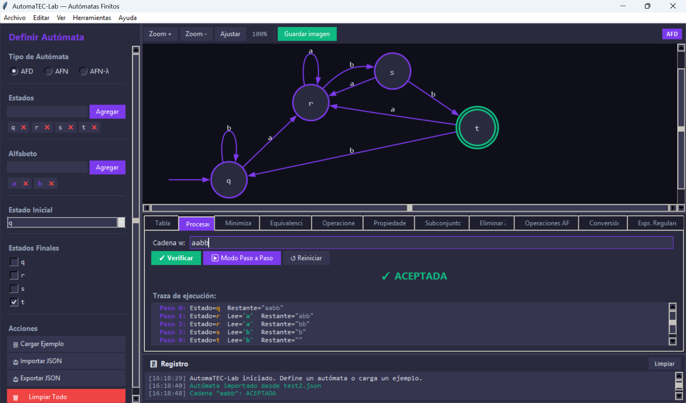
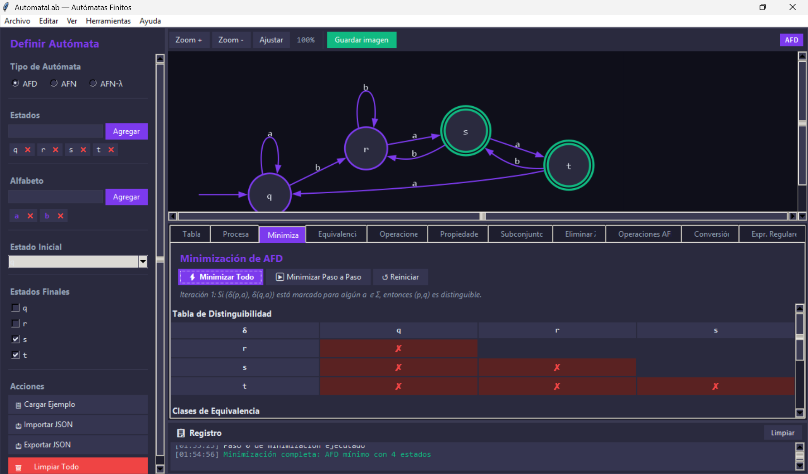
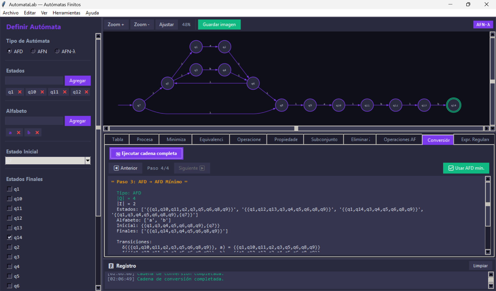
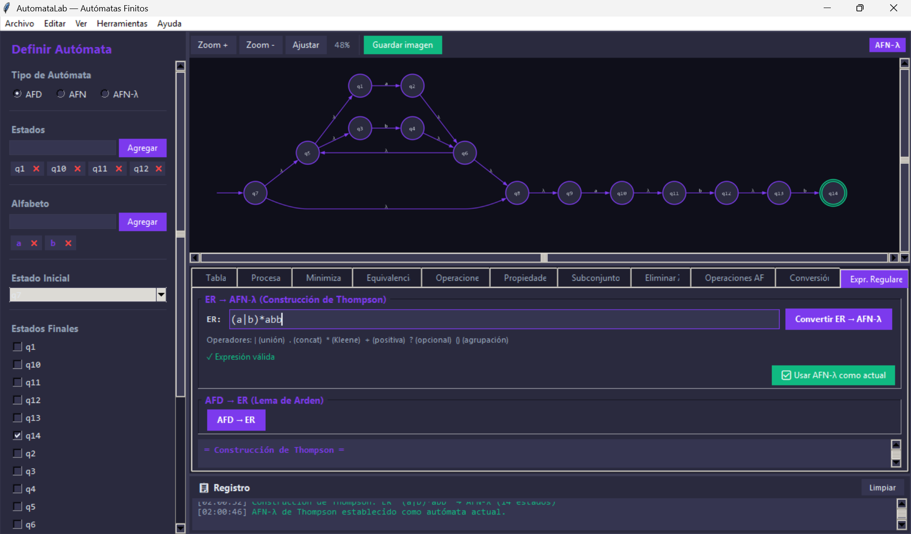

# AutomaTEC-Lab

[](https://doi.org/10.5281/zenodo.21264729)
[](https://opensource.org/licenses/MIT)
[](https://www.python.org/)
[](https://github.com/automatec70-ctrl/AutomaTEC-Lab/releases/tag/v1.1.2)

**AutomaTEC-Lab** is an open-source Python desktop application for the interactive design, visualization, and analysis of finite automata. It supports Deterministic Finite Automata (DFA), Nondeterministic Finite Automata (NFA), and λ-transition Automata (λ-NFA), providing a complete conversion pipeline between formalisms with step-by-step algorithm tracing.

Developed at **Tecnológico Nacional de México / Instituto Tecnológico de San Juan del Río**, AutomaTEC-Lab is designed for use in Formal Languages and Automata courses in Computer Systems Engineering programs.

---

## Screenshot



*Main interface showing the DFA for the language (a|b)\*abb, with automatic diagram generation and step-by-step string processing trace.*

---

## Features

- **Three automaton models** — DFA, NFA, and λ-NFA with interactive definition via form-based interface
- **Automatic diagram generation** — Powered by Graphviz DOT engine with zoom, pan, and auto-fit controls
- **Step-by-step string processing** — Full execution trace showing active state, consumed symbol, and remaining string at each step
- **DFA minimization** — Distinguishability table algorithm (Myhill-Nerode) with per-iteration display
- **Equivalence verification** — Symmetric difference construction with automatic witness string generation
- **Boolean operations** — Union, intersection, difference, and complement via Cartesian product construction
- **Language properties** — Empty, finite, or infinite language detection; accessible, productive, and useful state classification
- **Complete conversion pipeline** — λ-NFA → NFA → DFA → minimal DFA, navigable step by step
- **Thompson construction** — Regular expression → λ-NFA conversion with AST-based recursive algorithm
- **Arden Lemma** — DFA → Regular expression inverse conversion
- **High-resolution export** — PNG (300 DPI), SVG, PDF, and EPS diagram export
- **JSON import/export** — Save and load automata in human-readable JSON format
- **7 predefined examples** — Ready-to-use automata covering representative languages for each model
- **Bilingual interface** — Spanish and English, switchable at runtime via View → Language
- **Dark/light theme** — Toggle with Ctrl+T, no restart required

---

## Requirements

| Component | Minimum version | Notes |
|---|---|---|
| Python | 3.8 | Required |
| tkinter | — | Included with Python |
| Pillow | 9.0 | `pip install Pillow` |
| graphviz (Python) | 0.20 | `pip install graphviz` |
| Graphviz (system) | 2.40 | Install via system package manager |

### Installing Graphviz (system)

**Windows:**
```
winget install graphviz
```
or download from [graphviz.org/download](https://graphviz.org/download/)

**macOS:**
```bash
brew install graphviz
```

**Linux (Debian/Ubuntu):**
```bash
sudo apt install graphviz
```

**Linux (Fedora/RHEL):**
```bash
sudo dnf install graphviz
```

---

## Quick start (Windows)

For most users, two steps are enough:

1. **Run `install_windows.bat`** — installs Python, Tkinter, Graphviz, Pillow, and the graphviz Python package automatically. Internet connection required. Run this only once.
2. **Run `ejecutar.bat`** — opens AutomaTEC-Lab. Use this every time you want to start the application.

If the installation script shows a yellow warning from winget, that is normal — it falls back to a direct download automatically and no action is required.

---

## Installation

### Option 1 — Automated scripts (recommended)

**Windows:**
```
install_windows.bat
```
Automatically installs all dependencies (Python 3.11 with Tkinter, Graphviz, Pillow, graphviz Python package). Requires an internet connection. Run once; after that, use `ejecutar.bat` to launch the application.

**macOS / Linux:**
```bash
chmod +x install_linux_mac.sh
./install_linux_mac.sh
```

### Option 2 — Manual installation

```bash
# Clone the repository
git clone https://github.com/automatec70-ctrl/AutomaTEC-Lab.git
cd AutomaTEC-Lab

# Install Python dependencies
pip install Pillow graphviz

# Run the application
python main.py
```

---

## Usage

### Starting the application

**Windows (recommended):**
```
ejecutar.bat
```

**Any platform (command line):**
```bash
python main.py
```

### Basic workflow

1. **Select automaton type** — Choose DFA, NFA, or λ-NFA from the left panel
2. **Define states** — Add states using the "Agregar / Add" button; mark the initial state and final states
3. **Define alphabet** — Add symbols to the alphabet
4. **Enter transitions** — Fill in the transition table in the "Tabla / Table" tab
5. **Visualize** — The diagram updates automatically after each change
6. **Process strings** — Go to "Procesar / Process" tab, enter a string, and click "Verificar / Verify"

### Loading a predefined example

Click **"Cargar Ejemplo / Load Example"** in the left panel to open the example dialog. Select any of the 7 predefined automata and click "Cargar / Load".

---

## Functionalities

### String Processing (`Procesar / Process` tab)

Enter a string `w` and click **Verificar** for immediate accept/reject result with full execution trace. Use **Modo Paso a Paso / Step-by-step Mode** to navigate the trace one symbol at a time.

### DFA Minimization (`Minimiza / Minimize` tab)



Click **Minimizar Todo / Minimize All** to run the distinguishability table algorithm to completion, or **Minimizar Paso a Paso** to advance one iteration at a time. The table displays distinguishable pairs in red. The equivalence classes and resulting minimal DFA are shown below the table.

### Equivalence Verification (`Equivalenci` tab)

Load a second DFA and click **Verificar Equivalencia**. If the automata are not equivalent, a witness string — the shortest string accepted by one but not the other — is displayed automatically.

### Boolean Operations (`Operaciones / Operations` tab)

Select a second DFA and apply **Union**, **Intersection**, **Difference**, or **Complement**. The resulting DFA is displayed and can be saved or used for further operations.

### Language Properties (`Propiedades / Properties` tab)

Computes whether the language is **empty**, **finite**, or **infinite**, and classifies states as **accessible**, **productive**, or **useful**.

### Conversion Pipeline (`Conversión / Conversion` tab)

With a λ-NFA loaded as the current automaton, click **Ejecutar cadena completa / Run full pipeline** to execute all four conversion steps:

1. **Step 1/4** — Display original λ-NFA
2. **Step 2/4** — λ-NFA → NFA (eliminate λ-transitions via λ-closures)
3. **Step 3/4** — NFA → DFA (subset construction)
4. **Step 4/4** — DFA → minimal DFA (distinguishability table)

Use **Anterior / Previous** and **Siguiente / Next** to navigate between steps. Click **Usar AFD mín. / Use min. DFA** to set the result as the current automaton.



### Thompson Construction (`Expr. Regulares / Regular Expressions` tab)



Enter a regular expression using the supported operators:

| Operator | Meaning | Example |
|---|---|---|
| `\|` | Union | `a\|b` |
| `.` | Concatenation (implicit) | `ab` |
| `*` | Kleene star | `a*` |
| `+` | Positive closure | `a+` |
| `?` | Optional | `a?` |
| `()` | Grouping | `(a\|b)*` |

Click **Convertir ER → AFN-λ** to generate the λ-NFA. The expression is validated syntactically before conversion. Click **Usar AFN-λ como actual / Use as current λ-NFA** to set the result as the active automaton.

### Arden Lemma (`Expr. Regulares / Regular Expressions` tab)

With a DFA loaded, click **AFD → ER** to convert the current DFA to a regular expression using the Arden Lemma by state elimination.

---

## Predefined Examples

| # | Language | Model |
|---|---|---|
| 1 | Binary strings ending in 1 | DFA |
| 2 | Strings with an even number of zeros | DFA |
| 3 | (a\|b)*abb | DFA |
| 4 | Strings containing the substring "01" | DFA |
| 5 | a*b⁺ with ε-transitions | λ-NFA |
| 6 | Non-minimal DFA (for minimization practice) | DFA |
| 7 | Pair of equivalent DFAs | DFA |

---

## Export

| Format | Resolution | How to export |
|---|---|---|
| PNG | 300 DPI | Click "Guardar imagen / Save image" in the toolbar |
| SVG | Vector | File → Export → SVG |
| PDF | Vector | File → Export → PDF |
| EPS | Vector | File → Export → EPS |
| JSON | — | Left panel → "Exportar JSON" |
| CSV | — | Table tab → Export table |

---

## JSON Format

Automata are serialized in human-readable JSON. Example DFA:

```json
{
  "tipo": "AFD",
  "estados": ["q0", "q1", "q2"],
  "alfabeto": ["a", "b"],
  "estado_inicial": "q0",
  "estados_finales": ["q2"],
  "transiciones": {
    "q0": {"a": "q1", "b": "q0"},
    "q1": {"a": "q1", "b": "q2"},
    "q2": {"a": "q1", "b": "q0"}
  }
}
```

For NFA and λ-NFA, transition values are lists of states instead of single states. λ-NFA transitions use the key `"λ"` for epsilon transitions.

---

## Project Structure

```
AutomaTEC-Lab/
├── main.py                    # Application entry point
├── ejecutar.bat               # Windows launcher (run this to open the app)
├── install_windows.bat        # Windows installation script (run once)
├── install_linux_mac.sh       # macOS/Linux installation script (run once)
├── core/
│   ├── afd.py                 # DFA: definition, minimization, equivalence, operations
│   ├── afn.py                 # NFA: subset construction
│   ├── afn_lambda.py          # λ-NFA: ε-closure, λ-elimination
│   ├── regex.py               # Parser, Thompson construction, Arden Lemma
│   ├── serializer.py          # JSON/CSV import-export
│   ├── utils.py               # BFS, state renaming, validation
│   └── examples.py            # 7 predefined automata
├── ui/
│   ├── canvas_widget.py       # Graphviz-based diagram canvas
│   ├── sidebar.py             # Left panel: automaton definition
│   ├── table_widget.py        # Editable transition table
│   ├── string_processor.py    # String processing panel
│   ├── minimization_panel.py  # Minimization with step-by-step display
│   ├── equivalence_panel.py   # Equivalence verification
│   ├── operations_panel.py    # Boolean operations
│   ├── properties_panel.py    # Language properties
│   ├── afn_panels.py          # NFA conversion panels
│   ├── regex_panel.py         # Regular expression panel
│   ├── log_panel.py           # Event log
│   ├── examples_dialog.py     # Example loader dialog
│   ├── help_dialog.py         # Help dialog
│   ├── i18n.py                # Bilingual interface (ES/EN)
│   └── theme.py               # Dark/light theme manager
└── io/
    └── __init__.py            # I/O extension module
```

---

## How to Cite

If you use AutomaTEC-Lab in your research or teaching, please cite:

```bibtex
@article{gomezperez2026automaTEClab,
  title   = {{AutomaTEC-Lab}: An open-source {Python} application for
             interactive design and analysis of finite automata},
  author  = {G{\'o}mez-P{\'e}rez, V{\'i}ctor Alberto and
             Alberto-Lira, Roberto Enrique and
             Gonz{\'a}lez-Lorence, Armida and
             Jarillo-Silva, Alejandro and
             Ascencio-Laguna, Jos{\'e} Alejandro and
             Mendoza, Sonia},
  journal = {SoftwareX},
  year    = {2026},
  note    = {Under review}
}
```

Software release:

```
Gómez-Pérez VA, Alberto-Lira RE, González-Lorence A,
Jarillo-Silva A, Ascencio-Laguna JA, Mendoza S.
AutomaTEC-Lab v1.1.2 [Software]. Zenodo; 2026.
https://doi.org/10.5281/zenodo.21264729
```

---

## Authors

| Name | Affiliation |
|---|---|
| Víctor Alberto Gómez-Pérez | Tecnológico Nacional de México / Instituto Tecnológico de San Juan del Río |
| Roberto Enrique Alberto-Lira | Independent researcher |
| Armida González-Lorence | Tecnológico Nacional de México / Instituto Tecnológico de San Juan del Río |
| Alejandro Jarillo-Silva | Universidad de la Sierra Sur |
| José Alejandro Ascencio-Laguna | Tecnológico Nacional de México / Instituto Tecnológico de San Juan del Río |
| **Sonia Mendoza** *(corresponding author)* | Department of Computer Science, CINVESTAV-IPN |

Contact: victor.gp@sjuanrio.tecnm.mx

---

## License

The **source code** of AutomaTEC-Lab is distributed under the
[MIT License](https://opensource.org/licenses/MIT) — you are free to use, copy,
modify, merge, publish, distribute, sublicense, and/or sell copies of the software,
provided that the copyright notice and this permission notice are included in all copies.

The **documentation and associated manuscript** are licensed under
[Creative Commons Attribution 4.0 International (CC BY 4.0)](https://creativecommons.org/licenses/by/4.0/).

[](https://opensource.org/licenses/MIT)
[](https://creativecommons.org/licenses/by/4.0/)
